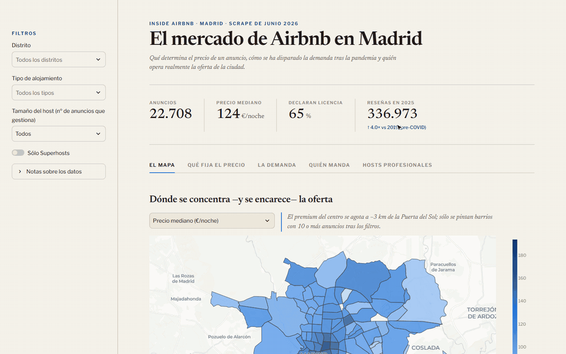
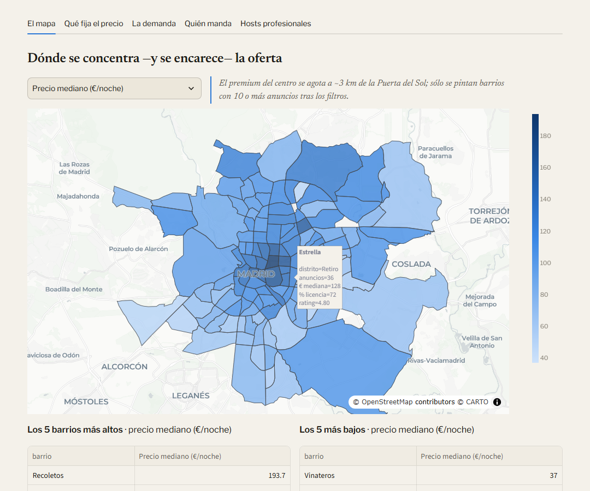
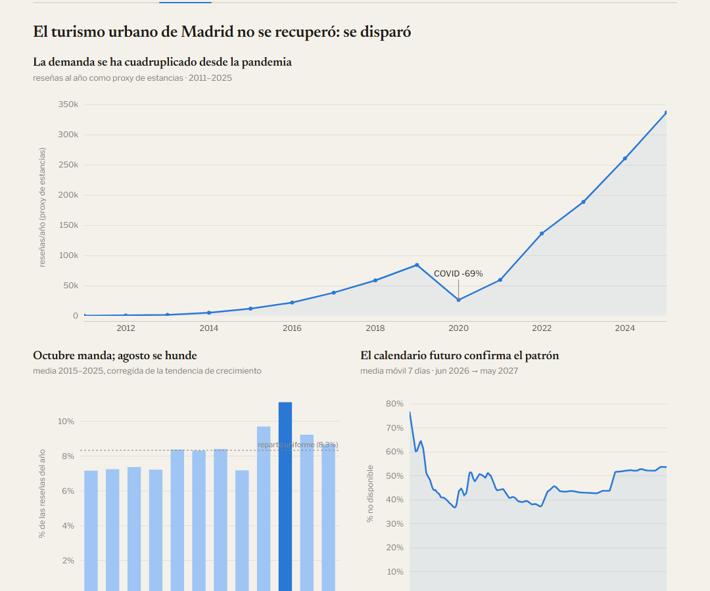
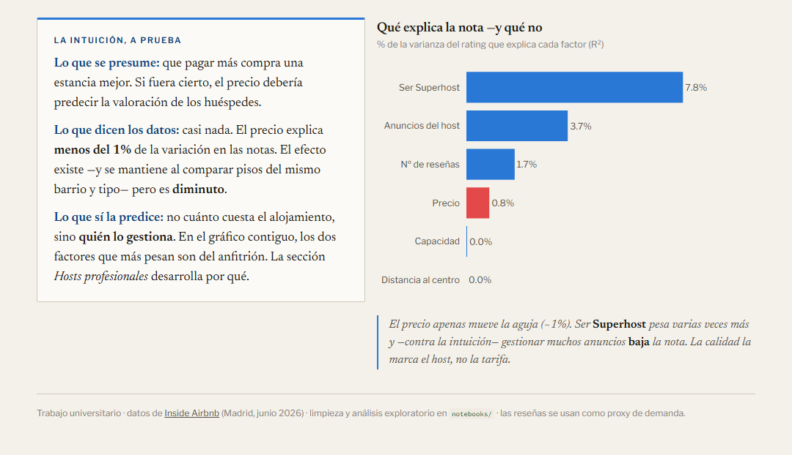
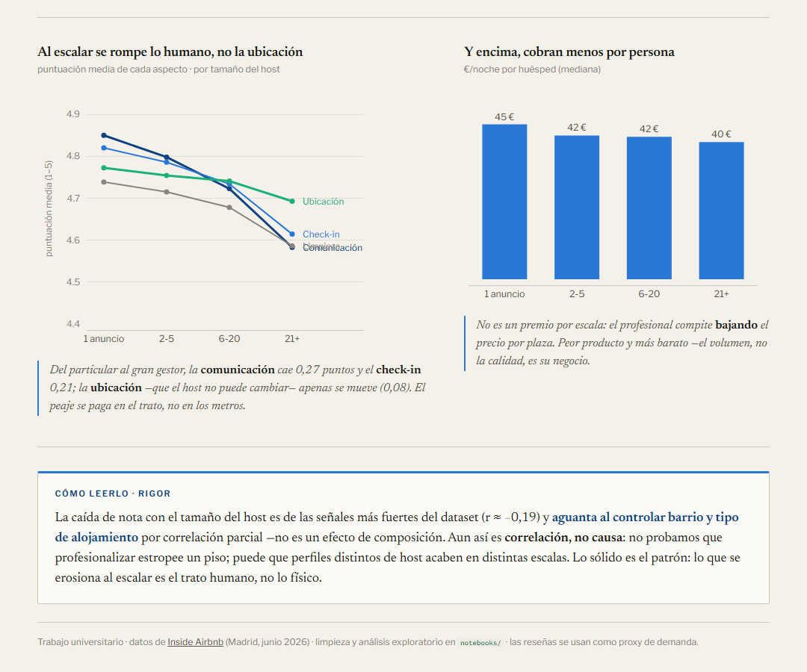

# The Airbnb market in Madrid

<p>
  
  
  
  
  
</p>

Interactive dashboard and exploratory analysis of short-term rentals in Madrid:
**22,708 listings, 1.4M reviews and 8.3M calendar days** from
[Inside Airbnb](https://insideairbnb.com/) (June 2026 snapshot). It answers four
questions: where supply concentrates, what drives price, how demand evolves and who
actually runs the market.



<sub>Course project for Data Visualization · MSc in AI & Big Data (UPV). The dashboard UI is in Spanish.</sub>

## Key findings

1. **Price follows size, not quality.** Capacity correlates r = 0.60 with log-price; rating,
   r = 0.09. The city-centre premium fades out about 3 km from Puerta del Sol.
2. **Paying more does not buy a better rating.** Price explains 0.8% of rating variance.
   Being a Superhost explains 7.8%.
3. **Scaling costs quality.** The more listings a host manages, the lower the rating
   (r = −0.19), and the effect holds within the same neighbourhood and room type. The drop
   concentrates on the human side (communication −0.27 pts, check-in −0.21) and barely
   touches location (−0.08), which the host cannot change.
4. **Demand did not recover, it took off.** 2025 reviews are four times those of 2019,
   after a 69% drop in 2020. Peak in October, trough in August: a city destination, not a
   beach one.
5. **30% of supply belongs to large operators** (21+ listings), and they charge less per
   guest than individual hosts (€40 vs €45).

<table>
  <tr>
    <td width="50%"></td>
    <td width="50%"></td>
  </tr>
  <tr>
    <td align="center"><sub>Price, supply, licences and rating by neighbourhood</sub></td>
    <td align="center"><sub>Historical demand, seasonality and forward calendar</sub></td>
  </tr>
  <tr>
    <td width="50%"></td>
    <td width="50%"></td>
  </tr>
  <tr>
    <td align="center"><sub>What explains the rating, as effect size (R²)</sub></td>
    <td align="center"><sub>Where quality breaks as hosts professionalise</sub></td>
  </tr>
</table>

## How it was built

```
Inside Airbnb CSVs (~750 MB)
  └─ notebooks/01  cleaning and conversion to Parquet
      ├─ notebooks/02  exploratory analysis
      ├─ notebooks/03  effect sizes and partial correlations
      └─ scripts/prepare_dashboard_data.py  pre-aggregation to ~2 MB
          └─ app.py  Streamlit + Plotly dashboard
```

- **Method.** Missing prices (15.5%) are not imputed because the gap carries information:
  those are inactive listings. Effect sizes (r²) and partial correlations are used instead
  of stopping at significance, which almost always shows up with 16,000 listings.
  Seasonality is detrended so that growth does not hide it.
- **Visual honesty.** No truncated or dual axes. A chart whose raw data would mislead is not
  published, even if it supports the narrative. Data limitations are stated inside the
  interface itself.
- **Design.** Editorial look (serif headlines, grotesque UI type), colour-blind-safe
  palette, direct labels instead of value axes, and global filters that apply to every tab.
- **Performance.** The app never touches the raw data: it reads four pre-aggregated files,
  so it responds instantly.

The full process is in the [project log](bitacora.md), including how a wrong finding was
caught and corrected. Users, goals and design decisions are in the
[design document](documento.md), and the initial sketch in [`mockup.pdf`](mockup.pdf).
These documents are in Spanish.

## Run locally

Requires Python 3.11 or later.

```bash
python -m venv .venv
source .venv/bin/activate        # Windows: .venv\Scripts\Activate.ps1
pip install -r requirements.txt
streamlit run app.py
```

It opens at http://localhost:8501. The sidebar filters (district, room type, host size and
Superhosts only) apply to every view.

## Project structure

```
app.py                              Dashboard
scripts/prepare_dashboard_data.py   Pre-aggregates data/processed/ -> data/dashboard/
notebooks/
  01_exploracion_limpieza.ipynb     Cleaning and conversion to Parquet
  02_analisis_exploratorio.ipynb    Price, location, demand and hosts
  03_hosts_profesionales.ipynb      Effect sizes on ratings
data/dashboard/                     Pre-aggregated data read by the app (~2 MB)
docs/img/                           Screenshots and GIF for this README
documento.md                        Design document
bitacora.md                         Project log: phases, decisions and iterations
```

## Data

Source: [Inside Airbnb](https://insideairbnb.com/), Madrid, June 2026, published under
[CC BY 4.0](https://creativecommons.org/licenses/by/4.0/).

The repository only includes `data/dashboard/`, which is enough to run the app. The original
CSVs (~750 MB) and the intermediate Parquet files in `data/processed/` are not versioned
because of their size. The notebooks keep their outputs, so they can be read without
re-running them. To reproduce them, download the Madrid files from Inside Airbnb into
`data/` using the names listed in the first table of notebook 01 (the detailed versions,
uncompressed, go as `listings_1.csv` and `reviews_1.csv`) and run the notebooks in order.
Then `python scripts/prepare_dashboard_data.py` regenerates the dashboard data.

**Limitations:** 15.5% of listings publish no price and are left out of the price analyses.
Reviews are a proxy for stays, not a booking record. "Declares a licence" means the listing
shows a registration number, not that it has been verified.
